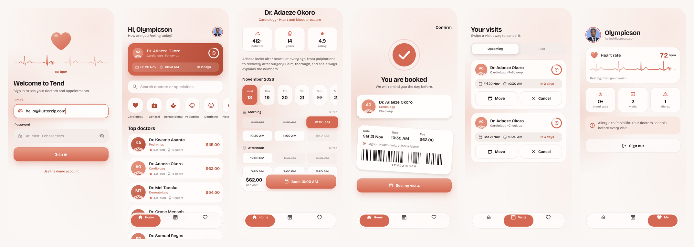
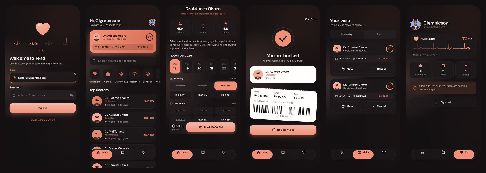

<p align="center">
  
</p>

<h1 align="center">Tend</h1>

<p align="center">
  A Flutter doctor booking app with a heartbeat. The sign-in heart races as
  you type, the calendar slides, and every booking ends in a ticket that
  tears off.
</p>

<p align="center">
  <a href="https://flutterzip.com"></a>
  <a href="https://instagram.com/flutter_zip"></a>
  
  
  
  
  
</p>

<p align="center">
  
</p>
<p align="center">
  
</p>

## Highlights

- **A heart monitor that is really drawn.** Each beat is a P wave, the QRS
  spike and a T wave; a bright head sweeps across like a bedside monitor,
  the old trace fades and a small gap erases ahead of it.
- **A heart that reacts.** On sign in the heart beats lub-dub and its rate
  climbs with every key you type, then settles back when you stop. The
  rate is integrated, so speeding up never jumps.
- **A splash that beats.** A flat line kicks into one heartbeat and draws a
  heart, which fills.
- **A booking calendar.** A coral pill slides between days on a spring;
  taken times are struck through; the chosen slot fills and pops.
- **A ticket that tears.** Booking draws a tick inside a pulse with rings
  spreading out, and the ticket's stub tears away from the top half.
- **Drawn portraits** for every doctor in steps of the one accent, a
  next-visit card with a countdown ring, swipe to cancel with undo, moving a
  visit to a new time, and light and dark from one palette file.

## Try the demo

- Tap **Use the demo account** (or type anything) and sign in. Watch the
  heart rate while you type.
- Tap a specialty, open a doctor, slide through the days, pick a time,
  choose a reason and book.
- In **Visits**, swipe a visit away and tap **Undo**, or **Move** it to
  another time.
- The round button on the right edge opens **Demo settings**: theme and
  reset demo data (which signs you out).

## Getting started

```bash
git clone https://github.com/flutterzip/tend.git
cd tend
flutter pub get
flutter run
```

Open a screen straight away: `--dart-define=startRoute=doctor` (also
`confirm`, `visits`, `me`). `--dart-define=timingScale=0` skips every wait.

## Make it yours

| To change | Edit |
|---|---|
| Every colour, light and dark | `lib/config/palette.dart` |
| Doctors, fees, clinics | `assets/data/doctors.json` |
| The person and their seeded visits (days from today) | `assets/data/profile.json` |
| Opening hours and slot length | `openSlots` in `lib/data/models.dart` |
| Which slots count as taken | `isFree` in `lib/state/store.dart` |
| The heartbeat's shape | `ecg()` in `lib/widgets/pulse.dart` |
| How things move | `lib/config/motion.dart` |
| The app's name and tagline | `lib/config/brand.dart` |

## Project structure

```
lib/
  config/     palette, theme, motion, timing, brand
  data/       doctors, slots, appointments, money and dates
  state/      the seed, sign in, appointments, free slots (Riverpod, saved)
  widgets/    the heart and monitor, portraits, calendar, slots, ticket;
              widgets.dart is one import for all
  screens/    sign in, home, doctor, confirm, visits, me, shell, splash
  demo/       Demo settings button and launch hooks
```

## How it is built

`ecg(phase)` is a sum of five Gaussian bumps, one per wave of a heartbeat.
The monitor keeps a short history of (time, beat phase) samples and draws
them along a sweep: the newest at the head, older ones behind it, fading.
Beat phase is integrated from the current rate each frame, so a heart that
speeds up stays continuous.

Appointments are stored with real times, while the seed gives them as days
from today so the demo never goes stale. Whether a slot is free is worked
out each time: not in the past, not on a Sunday, not in the doctor's fixed
pattern of taken times, and not already booked.

## Testing

```bash
flutter analyze --fatal-infos
flutter test
```

21 tests cover slots (past, closed days, taken, your own bookings),
booking, moving and cancelling with undo, saving, the heart racing while
you type, filtering and search, the full booking flow, sign in and out, the
splash handing over without rebuilding sign in, and that no on-screen
string has an em dash. `tool/shots.sh` takes the README screenshots on the
iOS simulator.

## Made by FlutterZip

A new Flutter UI every day. Follow [@flutter_zip](https://instagram.com/flutter_zip)
and find more at [flutterzip.com](https://flutterzip.com).

## Credits

- [Bricolage Grotesque](https://github.com/ateliertriay/bricolage) by
  Mathieu Triay, SIL Open Font License 1.1 (`assets/fonts/OFL.txt`).
- The heart, monitor line, portraits, ticket and icon are drawn in code for
  this project. Doctors and clinics are invented. Tend is a demo and gives
  no medical advice.

## License

MIT. See [LICENSE](LICENSE).
